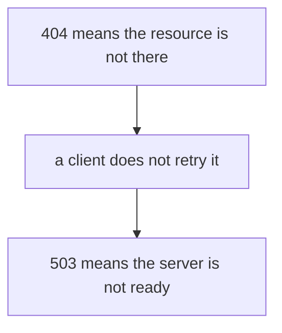

# Dialogue shape

Sample lines show the gate. They are not a source, and they are not the live task. The live slice comes from `02-now/tasks.md`. The map names nodes and does not explain them. A quote from the page comes after they try, or inside a node they could not reason to. Never open with the explanation.

## Probe, map, one node

Slice, for this sample only: a check that says why a missing page and a busy server get different HTTP status codes. Notes: https://developer.mozilla.org/en-US/docs/Web/HTTP/Reference/Status

User: learn

Agent: From memory, when a URL points at nothing, what does the server tell the client?

Then stop.

User: It says the page was not found. I think that is 404.

Agent: That root is held. Fetch of the status page comes before the map (**web**). Plan: from that not-found code, derive why a client leaves it alone, then why a busy server is a different code. The check is those two codes, not a recital of the page.

Say go.

User: go

Agent: Why would a client treat "not there" differently from "try again in a moment"?

Then stop. After they answer, state the claim from the fetched page, connect it to 404, and ask one check. Pass on the claim. Do not ask them to match the page's sentence.

## Bad: recite the sentence

The page says 404 means the resource was not found. The learner already said the resource is missing. Pass it. Do not drill the wording. Do not make a neighboring status code the check.

## Bad: lecture first

Agent: 404 is not found, 503 is unavailable, and clients retry only the second one. Read the page with that in mind.

That paragraph is the forbidden opening. A task line that only names the topic is not a definition. Pose the problem, or show the map and wait.
